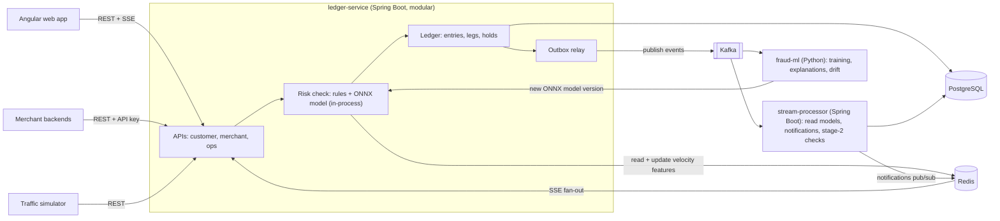

# Payments Ledger with Real-Time Fraud Detection: Design Document

Status: **design complete, pending mentor review.** No code has been written yet. Background, goals, and current status are in [CONTEXT.md](CONTEXT.md).

## Contents

1. [Product scope](#1-product-scope)
2. [Ledger and correctness](#2-ledger-and-correctness)
3. [Architecture](#3-architecture)
4. [ML](#4-ml)
5. [Performance and operations](#5-performance-and-operations)

---

## 1. Product scope

### 1.1 Transaction types

A digital wallet with merchants. Every transaction is one balanced journal entry: its legs sum to zero.

| Transaction (example) | Money out of | Money into |
|---|---|---|
| Top-up ₹1,000 | Bank clearing (system) | Customer: 1,000 |
| P2P transfer ₹200 | Alice | Bob: 200 |
| Merchant payment ₹500, 2% fee | Customer | Merchant: 490, Fee revenue (system): 10 |
| Refund of that payment | Merchant 490, Fee revenue 10 | Customer: 500 |
| Withdrawal ₹300 | Customer | Bank clearing (system): 300 |
| Fraud hold on a ₹200 transfer | Alice | Held funds (system): 200 |
| Hold released / rejected | Held funds | Bob (released) or Alice (rejected): 200 |

These map onto the PaySim fraud dataset's types: top-up = CASH_IN, withdrawal = CASH_OUT, P2P = TRANSFER, merchant payment = PAYMENT.

### 1.2 Currency

- **Core is single-currency** in base currency **INR**.
- The data model is currency-aware from day one: `currency` on every account and leg, and **each entry must balance per currency**.
- **Multi-currency is an optional module**, built after the core milestones, behind a feature flag, in its own **Currencies** tab:
  - A customer can open wallets in other currencies (e.g. USD, EUR).
  - A customer can convert between their own wallets using a **quote** whose rate is locked for 30 seconds.
  - P2P and merchant payments stay same-currency. Cross-currency payments are out of scope.
  - Conversion example, ₹8,400 → $100 at a customer rate of 84.00 (mid rate 83.58, the spread is platform revenue):

    | Currency | Money out of | Money into |
    |---|---|---|
    | INR | Alice INR wallet: 8,400.00 | FX pool INR (system): 8,358.00, FX revenue (system): 42.00 |
    | USD | FX pool USD (system): 100.00 | Alice USD wallet: 100.00 |

  - Rates come from a seeded rates table, optionally refreshed by a scheduled job.
  - Fraud features convert amounts to the base currency.

### 1.3 Merchants

- Merchants integrate **server to server through an API**, the way Stripe works: API keys plus an `Idempotency-Key` header on `POST /payments` and refunds.
- A small merchant dashboard: payments received, refunds, and API key management (create and revoke keys).

### 1.4 Roles

| Role | Does |
|---|---|
| Customer | Top up, send money, pay merchants, withdraw, view history, (optional) convert currency |
| Merchant | Receive payments and issue refunds through the API; small dashboard |
| Ops (fraud review + admin merged) | Review held transfers (release or reject, with score reasons), reconciliation reports, system and model dashboards |

Merging review and admin is fine for v1 because there are no manual balance adjustments. If v2 adds them, they'll need two-person approval (one ops user creates, a different ops user approves).

### 1.5 Traffic simulator (in scope)

A simulator creates customers and merchants and sends a steady stream of normal and fraudulent transactions through the public API. It supplies the data for the fraud model, the load for performance tests, and the activity for the demo. Its behavior and fraud patterns are in section 4.2.

### 1.6 Non-goals for v1

Real bank or card integration, KYC checks, merchant settlement batches, chargebacks and disputes, scheduled payments, interest, manual balance adjustments, cross-currency payments, and LLM features.

---

## 2. Ledger and correctness

### 2.1 Balances
- Customer and merchant accounts keep a **running balance** on the account row, updated in the same transaction as the journal insert.
- Each leg stores **`balance_after`**: statements get a running balance, and reconciliation can find exactly where any drift began.
- Held money moves into the held-funds system account, so there's no separate "available balance" column.
- **System accounts** (bank clearing, fee revenue, held funds, FX pools, FX revenue) don't keep a running balance. Their balance is computed from legs for reports and reconciliation. This stops them from becoming one locked row that every transaction waits on.
- **Busy merchants** get a dedicated load-test scenario. If one merchant account becomes a bottleneck, split its balance into N buckets.

### 2.2 Journal and events
- Double-entry tables: **entries** (one per transaction) and **legs** (one per account movement), append-only.
- The app's database role has **no UPDATE or DELETE** on journal tables. Corrections are new reversing entries.
- An **outbox** row is written in the same transaction as each entry; a relay publishes outbox rows to Kafka (sections 3.3 and 3.4).
- Balance on any past date = `balance_after` of the account's last leg before that date.

### 2.3 Concurrency
- Debits use a **conditional update**: `UPDATE accounts SET balance = balance - :amt WHERE id = :id AND balance >= :amt`. Zero rows updated means insufficient funds.
- All account updates in a transaction run in **ascending account ID** order, so opposite transfers can't deadlock.
- **READ COMMITTED** isolation. A Postgres UPDATE that waited on a row lock re-checks its WHERE against the newest row version.
- **`CHECK (balance >= 0)`** on customer and merchant accounts as a final safeguard.

### 2.4 Money
- Amounts are **`long` minor units** (paise, cents) in a `Money(amount, currency)` value object, stored as `BIGINT`.
- A `currencies` table holds each currency's decimal places (ISO 4217: INR 2, USD 2, JPY 0).
- Fees are set in **basis points**, rounded half-up; the merchant gets the remainder so legs always balance exactly.
- `BigDecimal` only for FX rate math, rounded once to the target currency.

### 2.5 Idempotency
- `idempotency_keys` table, unique on `(client_id, key)`, storing a request hash, status, and response. Inserted in the same transaction as the money movement.
- Same key + same request: return the stored response, no new entry.
- Same key + different request: 422.
- Two identical requests at the same moment: the second waits on the unique index, then returns the first one's response.
- Keys expire after 24 hours.

### 2.6 Proving correctness
- **Database rules:** a deferred constraint trigger checks at commit that each entry's legs sum to zero per currency; CHECK on balances; no UPDATE/DELETE on the journal.
- **Reconciliation job** (scheduled, and on demand from the ops dashboard): each account's balance equals the sum of its legs; all legs per currency sum to zero; every outbox row was published.
- **Concurrency test:** hundreds of threads move money randomly; afterwards total money is unchanged and no balance is negative.
- **Property-based tests** (jqwik) for posting rules.
- **k6 load test** with zero balance errors.

## 3. Architecture

### 3.1 Deployables

| Deployable | Responsibility | Why it's separate |
|---|---|---|
| `ledger-service` (Spring Boot) | Money, APIs, stage-1 risk check, outbox relay. Modules: accounts, payments, risk, ledger, ops, with boundaries enforced by Spring Modulith | The payment hot path stays in one process |
| `stream-processor` (Spring Boot) | Read models, notifications, stage-2 checks | Read-only side; scales on its own; rebuilds read models by replaying Kafka |
| `fraud-ml` (Python) | Training, ONNX export, explanations, drift reports | Different language and runtime |
| `simulator` | Generates customers, merchants, normal and fraudulent traffic | An external client that uses only the public API |
| `web` (Angular) | Customer, merchant, and ops UI | |

### 3.2 Fraud scoring in two stages
- **Stage 1, synchronous, in ledger-service before commit:** rules (limits, blocklist) plus the ML model scored in-process with ONNX, using features from Redis. Budget about 10 ms, hard timeout 30 ms.
  - Outcomes: **approve** (post normally), **hold** (money moves to held funds for ops review), **decline** (no money moves; the attempt is recorded).
  - **Fallback** when scoring fails or times out: rules only. Small amounts are approved, large amounts are held. A model outage never stops payments.
  - Velocity counters are updated in Redis **during** the check, so bursts are seen immediately.
  - Scored: P2P transfers, withdrawals, merchant payments. Merchant payments are only approved or declined, never held. Top-ups and refunds aren't scored.
- **Stage 2, asynchronous, in stream-processor after commit:** slower checks (for example, a recipient receiving from many new senders, a sign of a mule account). A hit flags the transaction for review or pauses the recipient's withdrawals.
- The live model runs **in Java via ONNX**. Python is used where latency doesn't matter: training, explanations, drift.

### 3.3 Event bus
- **Kafka** (KRaft mode, one broker locally).
- Justified by several independent consumers (read models, notifications, stage-2 checks, ML data capture) and by replay (rebuild read models, backfill features).
- Events are keyed by account ID so each account's events stay in order.

### 3.4 Outbox relay and delivery
- **Polling relay**: reads unpublished outbox rows in batches with `FOR UPDATE SKIP LOCKED`, publishes, marks them sent. Postgres `LISTEN/NOTIFY` wakes it right away instead of waiting for the next poll.
- **At-least-once delivery.** Each consumer stores processed event IDs in the same transaction as its own work, so duplicates are skipped.
- Debezium CDC is a v2 option.

### 3.5 Authentication
- Customers and ops users log in and receive a JWT. Roles: `CUSTOMER`, `OPS`.
- Merchants use API keys of the form `pk_live_<id>_<secret>`. Only a hash of the secret is stored; keys can be revoked from the dashboard.
- The simulator logs in as its generated customers and merchants, like real clients.

## 4. ML

### 4.1 Training data
- The live model trains on **simulator traffic that went through the real system**.
- **PaySim** is used to calibrate the simulator (transaction-type mix, amount distributions, fraud rate) and in a **separate leakage study** notebook: a naive model scores near-perfect because of the balance columns; the realistic score comes after removing them. Verify on load: sender accounts almost never repeat, and the balance columns leak the label.
- To keep the simulator from being too easy: normal and fraud behavior overlap, one fraud pattern is held out of training, and all results are labeled synthetic.

### 4.2 Simulator behavior
- **Normal:** monthly salary-like top-ups; regular P2P within a friends graph; rent (large, monthly, same recipient); merchant payments with daily/weekly rhythm and festival peaks; occasional gifts to new recipients (legitimate but risky-looking).
- **Fraud patterns:**

  | Pattern | What happens |
  |---|---|
  | Account takeover | New device signs in; the account is drained to a new recipient within minutes |
  | Mule network | Many victims send to one recipient who withdraws quickly. **Held out of training**; stage-2 rules should catch it |
  | Account testing | A few tiny payments, then a large one |
  | Scam | The victim's own device sends a large transfer to a never-paid recipient (hard to detect) |

- **Device ID** on every request (Angular stores one per browser; the simulator assigns them).
- Fraud rate about **0.2–0.5%** of scored transactions.

### 4.3 Features and training/serving consistency

| Group | Examples |
|---|---|
| Transaction | amount, type, hour of day, amount ÷ sender's 30-day average |
| Sender velocity | count and sum over 1 h and 24 h, distinct recipients in 24 h |
| Recipient | first payment from this sender, recipient account age, distinct senders in 24 h, share of inbound money withdrawn within 24 h |
| Device | new device for this account, accounts seen on this device in 24 h |
| Account | sender account age, days since last activity |

- About 20 features, versioned together as a **feature set**.
- **Log-and-wait:** stage 1 logs the exact feature vector, model version, and decision for every scored transaction to `risk.decisions`. Training joins those vectors with labels, so training and serving can't disagree.
- A new feature only has training data from the moment it's added. Raw events stay in Kafka and the journal so a replay backfill tool can be added in v2.
- **First model:** run rules-only while logging features, train v1, run it in shadow mode, then promote.
- Windows run on real time: collecting data means running the simulator for about a day (20 tx/s ≈ 1.7M transactions, roughly 5,000 fraud cases).

### 4.4 Labels, splits, metrics, thresholds
- **Labels:** simulator ground truth, reported 10 minutes to 6 hours later on a labels topic. Ops review decisions are logged separately and can be scored against the truth.
- **Time-based split:** first 70% train, next 15% validation, last 15% test.
- **Imbalance:** no oversampling; class weights in LightGBM; thresholds tuned on validation; probabilities calibrated with isotonic regression.
- **Metrics:** PR-AUC; recall with holds capped at ops review capacity; money-weighted recall (₹ caught ÷ ₹ of all fraud); legitimate transfers held per 10,000; recall per fraud pattern, including the held-out one.
- **Thresholds:** hold threshold from ops review capacity; decline threshold where at least 95% of declines are fraud.

### 4.5 Model
- **LightGBM**, compared against rules-only and logistic regression baselines.
- Exported to **ONNX**; a parity test checks Java and Python scores match on the test set (max difference < 1e-5).
- p99 scoring latency measured in Java.

### 4.6 Explanations
- When a hold is created, fraud-ml loads the same model version, computes **TreeSHAP**, and stores the top 3 contributions on the hold.
- The UI shows them as sentences ("Amount is 12× this sender's 30-day average") next to any rules that fired.

### 4.7 Model lifecycle
- **v1:** `models` table (file, metrics, feature-set version, training window, one active version); hot reload in ledger-service; **shadow mode** for candidates; manual retraining (script or ops button); daily **PSI drift report** on scores and top features.
- **v2:** scheduled retraining, automatic promotion rules, replay backfill.
- Keep a small random sample of approved transactions for unbiased evaluation, because holds get labels faster than approvals.

## 5. Performance and operations

### 5.1 Fast responses to the UI

Targets are server-side p99 at the simulator's normal load, to be validated with k6.

| Screen / call | How it's served | Target |
|---|---|---|
| Wallet balance | Primary-key lookup on `accounts`; no cache | < 10 ms |
| Transaction history | Covering index on legs + keyset pagination + primary-key join to 20 entries | < 20 ms |
| Send money / pay | One short transaction; no network calls inside it; response includes the new balance | < 100 ms, including the stage-1 risk check (about 10 ms budget, section 3.2) |
| Merchant totals | Pre-aggregated stats table updated by an event consumer | < 10 ms |
| Ops review queue | `holds` table with a partial index on pending holds | < 10 ms |
| Ops dashboards | Prometheus metrics + stats tables, never live scans of the journal | < 50 ms |

**Write path**
- Keep transactions short: idempotency insert, conditional balance updates, batched leg inserts, outbox insert, commit. Never call the fraud service, Kafka, or any other network service while holding row locks.
- `accounts` uses `fillfactor = 85` and `balance` isn't indexed, so balance changes are HOT updates (no index writes). Autovacuum is tuned more aggressively on `accounts` because its rows change constantly.
- Legs get as few indexes as possible; every index slows every insert.
- `synchronous_commit` stays on for money. Non-money writes (notifications, stats) may use `SET LOCAL synchronous_commit = off`.
- HikariCP pool kept small (about 2x CPU cores). Too many connections slows Postgres down.

**Read path**
- History index: `legs (account_id, posted_at DESC, id DESC) INCLUDE (amount, balance_after, entry_id)`.
- **Keyset pagination** instead of OFFSET: `WHERE account_id = ? AND (posted_at, id) < (?, ?) ORDER BY posted_at DESC, id DESC LIMIT 20`. Page 1,000 is as fast as page 1.
- Display data (type, counterparty name, description) is stored on the entry when it's posted, so history needs no joins to user tables. The statement shows the name as it was at the time.
- Merchant totals and ops stats come from **read models**: small tables updated by event consumers, a few seconds behind. Updating them inside the payment transaction would lock one busy merchant row on every payment.
- **Partitioning the journal by month is deferred.** We measure history queries at 10M+ and 50M+ legs from the simulator and partition only if the numbers call for it.
- Optional later: a read replica for ops search and reports. A customer's own balance and history always read from the primary, so they see their transfer immediately.

**What's cached (Redis) and what isn't**
- Cached: FX rates, merchant API key lookups (60 s TTL, cleared on revoke), display names.
- Never cached: balances and history. A primary-key lookup is already fast, and a stale balance is a correctness bug.

**Backend to UI**
- POST responses return the created transaction and the new balance, so the UI updates without a second request.
- Real-time updates (money received, hold released) are pushed over SSE from an event consumer, instead of the UI polling.
- The Angular client creates the `Idempotency-Key` for each send. A retry after a network error reuses the key, so double-clicks and retries can't send money twice.
- Response compression on; history pages of 20 items.

**Measuring**
- `pg_stat_statements` and `auto_explain` (log plans for queries over 100 ms).
- Micrometer timers per endpoint; k6 scenarios in section 5.2.

### 5.2 Load testing

Starting targets for a laptop, adjusted after the first real measurement.

| Metric | Target |
|---|---|
| Sustained throughput | 500 transfers/sec with p99 < 100 ms, including the stage-1 check |
| Burst | 1,000 transfers/sec for 60 s with no errors |
| Stage-1 risk check | p99 < 10 ms |
| Balance errors | 0, checked by reconciliation after every run |

The simulator produces realistic traffic for the ML side. k6 produces controlled load for measuring performance.

| k6 scenario | What it shows |
|---|---|
| Steady mix, 30 min | No memory leaks or connection pool exhaustion |
| Ramp to failure | Maximum throughput while p99 stays under 100 ms (the capacity number) |
| Busy merchant: 300 payments/sec to one merchant | Whether that merchant's balance row is a bottleneck; measured before and after splitting it into buckets (section 2.1) |
| Many transfers from one account at once | No overdrafts; how long transfers wait on the row lock |
| Same idempotency key sent 10 times at once | Exactly one entry is created |
| Failure injection | Kafka stopped for 2 min: payments continue and the outbox catches up afterwards. Model stopped: rules fallback. Redis stopped: rules fallback (see below) |

For payments to keep working while Redis is down: the stage-1 check falls back to rules (its features live in Redis), API key lookups go to Postgres, rate limiting falls back to in-memory limits per instance, and SSE notifications pause until Redis is back.

### 5.3 Running and deploying

Docker Compose with profiles, so only the needed services start:

| Profile | Services |
|---|---|
| `core` | Postgres, Redis, Kafka (KRaft), ledger-service, stream-processor, web |
| `ml` | fraud-ml |
| `sim` | simulator |
| `obs` | Prometheus, Grafana, Jaeger |

- Day to day: infrastructure in Docker, Java services run from the IDE.
- The full stack needs about 6–8 GB of RAM. It's built and run on the personal laptop, because the work laptop can't run Docker.
- **Public deployment for v1:** none. A 2-minute demo video plus the results tables in the README. If an interviewer asks for a live demo, start a cloud VM for it.

### 5.4 Observability

- **Metrics** (Micrometer → Prometheus → Grafana):
  - latency and throughput per endpoint
  - outbox lag (age of the oldest unpublished row) and Kafka consumer lag
  - stage-1 latency and rules-fallback rate
  - hold and decline rates, and the model score distribution
  - reconciliation status and database pool usage
- **Tracing** (OpenTelemetry → Jaeger): trace context travels in Kafka message headers, so one trace follows a payment from the API through the outbox and Kafka to stream-processor.
- **Logs:** structured JSON with the trace ID and transaction ID. API keys and secrets are masked.
- **Alerts** (Grafana): reconciliation mismatch, outbox lag over 30 s, consumer lag, fallback rate over 5%, p99 above target.
- **Two audiences:** Grafana is for engineers. The Angular ops dashboard shows business numbers from the read models.

### 5.5 Testing and CI

| Test | Covers |
|---|---|
| Unit + property-based (jqwik) | Posting rules, `Money`, fee rounding, feature functions |
| Integration (Testcontainers: Postgres, Kafka, Redis) | Full transfer path; outbox → Kafka → consumer, including duplicate events |
| Concurrency | Total money unchanged and no negative balances under hundreds of threads |
| Architecture (Spring Modulith) | Modules only use each other's public APIs |
| ONNX parity | Java and Python scores match (section 4.5) |
| Python (pytest) | Training pipeline; logged feature vectors match what the simulator expects |
| API docs | OpenAPI spec generated with springdoc, used as the merchant API docs |

**CI:** GitHub Actions runs the Java build and tests (Testcontainers works on GitHub's runners), the Angular build and lint, and the Python tests.

### 5.6 Rate limiting and secrets

- **Rate limiting:** Bucket4j backed by Redis, per merchant API key and per customer. Requests over the limit get a 429 with a `Retry-After` header. Falls back to in-memory limits if Redis is down.
- **Secrets:** environment variables and a `.env` file that's never committed. No hardcoded JWT signing keys or database passwords.

### 5.7 Milestones

Effort assumes about 10 hours a week. Adjust once weekly hours are known.

| # | Milestone | Done when | Effort |
|---|---|---|---|
| M0 | Setup | Repo, Docker Compose (Postgres, Redis, Kafka), CI skeleton | 0.5 wk |
| M1 | Ledger core | All posting rules, conditional updates, idempotency, deferred trigger, reconciliation; concurrency test passes | 2 wk |
| M2 | APIs + auth | Customer JWT, merchant API keys, OpenAPI docs, all transaction endpoints, keyset-paged history | 1.5 wk |
| M3 | Events | Outbox relay → Kafka → stream-processor read models; notifications over SSE; basic metrics | 2 wk |
| M4 | Angular UI | Wallet, merchant dashboard, ops pages (reconciliation, review queue shell) | 2 wk |
| M5 | Risk stage 1 (rules only) | Holds, review queue, Redis features, device IDs, feature logging to `risk.decisions` | 1.5 wk |
| M6 | Simulator | Normal behavior + fraud patterns + delayed labels; about a day of data collected | 1.5 wk |
| M7 | ML | Training pipeline, baselines, LightGBM, calibration, thresholds, ONNX + parity test, hot reload, shadow mode, SHAP on holds, drift report, PaySim leakage study | 3 wk |
| M8 | Stage 2 | Mule-network check; recall on the held-out pattern measured | 1 wk |
| M9 | Performance | All k6 scenarios, tuning, busy-merchant fix if needed, failure injection; results recorded | 2 wk |
| M10 | Observability | Grafana dashboards, tracing across Kafka, alerts | 1 wk |
| M11 | Multi-currency (optional) | Currencies tab, quotes, conversions | 1.5 wk |
| M12 | Ship | README, architecture diagram, results tables, demo video, resume bullets | 1 wk |

**Total:** about 20.5 weeks, or 19 weeks without multi-currency.

**Minimum version if time runs short:** M0–M7, M9, and M12, about 17 weeks. Stage 2, full observability, and multi-currency can follow later.
